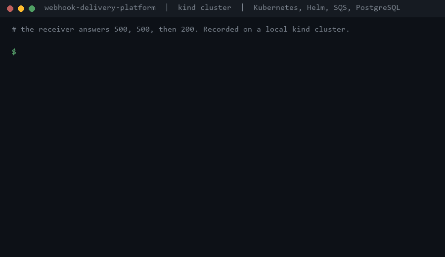
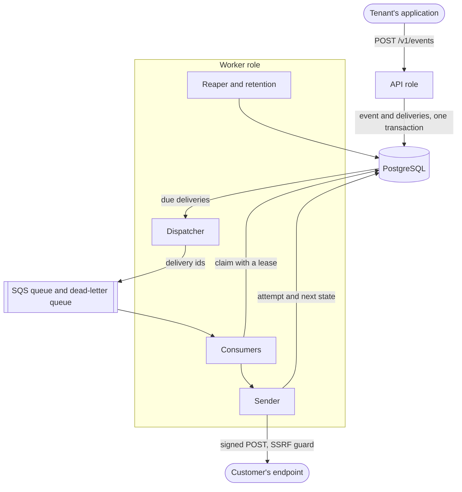
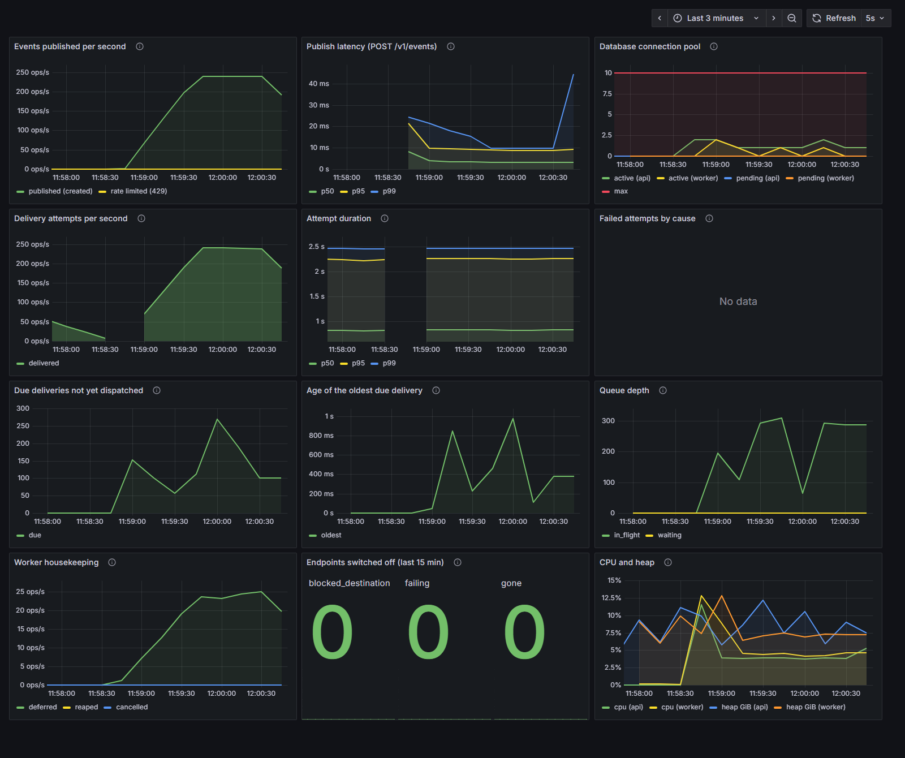

# webhook-delivery-platform

[](https://github.com/EmilioPG13/webhook-delivery-platform/actions/workflows/ci.yml)

Reliable, signed webhook delivery with retries, a dead-letter flow and SSRF protection. It accepts events from other
applications and delivers them to the HTTP endpoints its customers register. The point of the project is what happens
when things go wrong: receivers that are down, slow, or hostile, and workers that die at the worst moment.

Java 25, Spring Boot 4.1, PostgreSQL 18, Amazon SQS, Kubernetes. It was deployed once to AWS (EKS, RDS, SQS) for a short
demo window and torn down, see [Deployment and cost](#deployment-and-cost). It has no public URL and is not hardened for
the internet, so do not expose it.



A receiver that answers `500` twice and `200` the third time, on a local `kind` cluster. The attempts and their times
are the real ones from a recorded run (the stub is `/flaky` in [load/receiver/mappings/](load/receiver/mappings/flaky.json));
only the waits between them are sped up 25 times, as the animation says. The whole run took 135 seconds.

## Run it in a few minutes

Requires Docker. A JDK 25 is only needed to run the tests or work on the code.

```powershell
git clone https://github.com/EmilioPG13/webhook-delivery-platform.git
cd webhook-delivery-platform
docker compose up --build -d --wait
```

`--wait` returns once the API and the worker report healthy. This starts PostgreSQL, ElasticMQ (a local SQS), the API on port 8081, a worker, Prometheus, Grafana and a WireMock
receiver on port 8090 that stands in for a customer's server. Create a tenant with the operator token, register the
receiver as an endpoint, and publish an event with the API key the first call returned:

```powershell
curl.exe -X POST http://localhost:8081/admin/tenants -H "Authorization: Bearer dev-admin-token" `
  -H "Content-Type: application/json" -d '{\"name\":\"Acme\"}'

curl.exe -X POST http://localhost:8081/v1/endpoints -H "Authorization: Bearer <api key>" `
  -H "Content-Type: application/json" `
  -d '{\"url\":\"http://receiver:8080/ok\",\"event_types\":[\"order.paid\"]}'

curl.exe -X POST http://localhost:8081/v1/events -H "Authorization: Bearer <api key>" `
  -H "Content-Type: application/json" `
  -d '{\"type\":\"order.paid\",\"data\":{\"order_id\":\"A-1001\"}}'
```

Look at what the receiver got, signature headers included, at http://localhost:8090/__admin/requests, and at the
delivery with `GET /v1/deliveries?event_id=<event id>`. Point an endpoint at `http://receiver:8080/flaky` (it answers `500`
twice, then `200`) or at `/fail500` (always `500`) to watch retries: the delivery goes back to `pending` with the date
of the next attempt, and every attempt is listed at `GET /v1/deliveries/<id>/attempts`. The first retry comes after
about 30 seconds, the second after about 2 minutes. The API documentation is at `/swagger-ui/index.html`.

The secrets in `compose.yaml` are public throwaways for local use. The same file turns the destination guard off
(`WEBHOOKS_ENDPOINTS_ALLOW_PRIVATE_DESTINATIONS`), because the receiver it starts has a private address; never set that
in a real deployment. How long this takes is in the results table below.

## How it works



One jar, two roles. The `api` role serves the HTTP API and is stateless. The `worker` role (`worker` Spring profile) runs
the dispatcher, the queue consumers, the reaper and the other scheduled jobs, and scales separately.

The life of an event:

1. A tenant publishes with its API key. The publish is rate limited per tenant and validated, and an `Idempotency-Key`
   makes repeats and concurrent duplicates produce exactly one event.
2. In **one transaction** the event and one delivery per subscribed, active endpoint are inserted. PostgreSQL is the
   source of truth; this is a transactional outbox.
3. The dispatcher takes due deliveries with `FOR UPDATE SKIP LOCKED`, marks them `enqueued`, commits, and only then sends
   their ids to SQS.
4. A consumer reads a message and claims the delivery with a lease, in its own statement.
5. The sender signs the body and POSTs it, holding **no database transaction**, through an address guard that refuses
   private ranges.
6. The attempt and the next state (`delivered`, `pending` with a new date, or `failed`) are recorded in one short
   transaction, and only then is the queue message deleted.

## What happens when things fail

The guarantee is **at least once**: an event may arrive twice, never zero times if it could be delivered
([ADR 1](adr/0001-at-least-once-delivery.md)). Each row below has a test that causes the failure.

| What fails | What happens | Test |
|---|---|---|
| A worker dies after sending and before recording | The lease expires, the delivery comes back, the receiver gets the request twice with the same `webhook-id`, and the delivery still ends `delivered` | `WorkerCrashTest` |
| SQS is down | Deliveries wait as `enqueued`, the reaper gives them back, and they flow once the queue returns | `InfrastructureOutageTest` |
| The database fails at the claim | The message is kept and redelivered | `InfrastructureOutageTest` |
| A receiver answers slowly or drips bytes | A 15 second deadline covers the whole exchange, not each read | `WebhookSenderTest` |
| A receiver keeps failing | Retries follow the schedule below, then a circuit breaker switches the endpoint off; `enable` brings it back | `EndpointBreakerTest` |
| A receiver answers `410 Gone` | The delivery ends and the endpoint is switched off at once | `EndpointBreakerTest` |
| One slow endpoint | It cannot take every delivery slot of a worker | `EndpointConcurrencyTest` |
| 20 identical publishes at once | One event | `ConcurrentPublishTest` |
| A worker is replaced during a rolling update | 0 lost deliveries in 3 runs; the same update with the grace period cut short duplicates 45, so the test can fail | `deploy/local/rollout-test.ps1` |

A finished delivery can be sent again with `POST /v1/deliveries/{id}/replay`, which creates a new delivery and leaves the
original's history alone.

## Security

- **Signatures** follow [Standard Webhooks](https://github.com/standard-webhooks/standard-webhooks/blob/main/spec/standard-webhooks.md):
  HMAC-SHA256 over `webhook-id`, `webhook-timestamp` and the raw body.
- **SSRF.** The worker refuses to connect to private, loopback, link-local and other reserved addresses, judged at the
  moment of connecting so DNS rebinding does not work, and it never follows redirects
  ([ADR 7](adr/0007-ssrf-guard-at-connect-time.md)). On Kubernetes a NetworkPolicy backs it up at the network level.
- **Secrets.** Endpoint secrets are encrypted at rest with AES-256-GCM under a versioned key
  ([ADR 8](adr/0008-endpoint-secrets-encrypted-in-postgres.md)). API keys are stored as SHA-256 hashes. Keys and secrets
  are never logged, and a test fails if one is.
- **Tenants** are isolated: every query takes the tenant from the authenticated key, and another tenant's row is a `404`.
- [adr/0003-threat-model.md](adr/0003-threat-model.md) says what is protected, from whom, and what is not covered.

### Verifying a webhook as a receiver

A receiver that wants to trust what it gets should, in this order:

1. Compute HMAC-SHA256 over `webhook-id`, `.`, `webhook-timestamp`, `.` and the **raw request bytes**,
   with the endpoint's secret (the part after `whsec_`, base64-decoded), and compare it in constant
   time with the `v1,` signature in `webhook-signature`.
2. Reject the request if `webhook-timestamp` is more than 5 minutes from its own clock.
3. Deduplicate by `webhook-id`, remembering ids for at least 48 hours. Every attempt of an event
   carries the same id, and a retry can arrive hours later with a fresh timestamp, so step 2 does not
   protect against duplicates.
4. Answer `2xx` once the event is safely stored; anything else is treated as a failure and retried.

## Retries

Ten attempts over about 47 hours, with 20% jitter, honoring `Retry-After` on `429` and `503`
([ADR 6](adr/0006-retry-schedule.md)).

| After attempt | 1 | 2 | 3 | 4 | 5 | 6 | 7 | 8 | 9 |
|---|---|---|---|---|---|---|---|---|---|
| Wait | 30 s | 2 min | 10 min | 30 min | 1 h | 3 h | 6 h | 12 h | 24 h |

The tenth failure marks the delivery `failed`. A per-endpoint circuit breaker switches an endpoint off after 50 failures
in a row that lasted at least 24 hours; its pending deliveries are cancelled after 7 more days. Events, deliveries and
attempts are deleted after 30 days ([ADR 12](adr/0012-retention.md)).

## Observability

`docker compose up` also starts Prometheus (<http://localhost:9090>) and Grafana (<http://localhost:3000>, no
login). The dashboard in [observability/](observability/grafana/dashboards/webhooks.json) shows publish and
delivery rates, attempt duration, failures by cause, the backlog (how many deliveries are due and how long the oldest
has waited, read from PostgreSQL), the queue depth, the database connection pool, CPU and heap.

Metric labels are few and bounded on purpose (`outcome`, `error_kind`, `reason`): a tenant or endpoint id as a label
would create a time series per id. A test fails if one appears. The scrape path `/actuator/prometheus` answers only
to the operator token.



The dashboard during a k6 run of 240 events per second against a slow receiver (median 800 ms), with the worker
allowed 1,000 deliveries in flight. k6, the application and the receiver shared one machine.

## Measured results

Measured with k6 on one machine that also ran the application, the database and the receiver: AMD Ryzen 7 5700X
(8 cores), 31.9 GB, Windows 11, Docker Desktop. That makes every absolute figure a lower bound. Three runs per row,
range shown, 2026-10-08, commit `25b907e`, with one exception noted in the setup of load/RESULTS.md. Every run,
the setup and the caveats are in [load/RESULTS.md](load/RESULTS.md); the scenarios are in [load/](load/README.md).

| Scenario | Metric | Result (3 runs) |
|---|---|---|
| Sustained publishing, healthy receiver | Highest rate tried with publish p95 under 200 ms | 400 events/s (p95 9.5 to 11.0 ms). At 800/s the PostgreSQL rate limiter fails (p95 1.4 to 1.5 s) |
| Same, rate limiter in memory | Same | 800 events/s (p95 5.6 to 20.4 ms) |
| Rate limiter in PostgreSQL against memory | Added mean publish latency at 400/s | about 2 ms (5.4 to 5.7 ms against 2.9 to 3.7 ms) |
| Publish to first attempt, 250 events/s | p50 / p95 / p99 | 0.57 to 0.59 s / 1.00 s / 1.03 to 1.05 s (dominated by the 1 s dispatcher tick) |
| Slow receiver (median 800 ms), 50 events/s | Deliveries per second before the consumer fix ([ADR 4](adr/0004-consumer-concurrency.md)) | 12.8 to 13.1 (drain 253 to 263 s after publishing) |
| Same, after the fix | Deliveries per second | 47.1 to 47.9 (drain 5 to 8 s) |
| Failure storm to `/fail500`, breaker shortened to 30 s | Time until every endpoint is switched off | 33 to 35 s after the start, 20 of 20 endpoints |
| Virtual against platform threads, about 300 deliveries in flight ([ADR 9](adr/0009-virtual-threads-over-webflux.md)) | Deliveries per second | 226.9 to 230.2 against 229.3 to 231.2; worker threads 36 against about 1,036 |
| Container image, on disk (`docker images`, 2026-10-09) | Size | 654 MB: the JRE base image is 490 MB, the application jar and curl for the healthcheck make up the rest |
| Rolling update of the worker under load, local Kubernetes (kind), 15 events/s for 120 s, 5 s receiver | Events lost / duplicated | 0 / 0 in 3 runs (1,800 to 1,801 events each). The same update with the shutdown grace cut to 1 s: 0 lost, 45 duplicated |
| Rolling update of the API under the same load | Events lost, failed publishes | 0 and 0 of about 1,822 requests in 3 runs |
| Image start time on kind | Container start to Ready | median 20 s (19 to 20 s, 12 pods), probe periods included |
| Smoke run on EKS, 50 events/s for 60 s, 2 nodes, 2 API and 2 worker pods | Accepted / delivered / failed | 3,001 of 3,001 / 3,001 / 0, p95 publish 40 ms. One run, so it shows the stack works there and is not a measurement |
| Clean clone to first delivery, following this README (2026-10-12, commit `98c8e97`, the same machine) | Seconds | 74 s, and about 86 s with the image rebuilt without the layer cache. One run each. The base images and the Docker build cache of the Maven dependencies were already on the machine, so a first run elsewhere also pays for downloading them, which was not measured |

The three Kubernetes rows on kind come from a different setup (2026-10-10, a single-node cluster on the same machine, k6
inside the cluster, one commit later than the rows above); [load/RESULTS.md](load/RESULTS.md) section f has the runs and
the caveats. Section g has the EKS run.

## Decisions

Each one records the context, what was chosen, and what was rejected.

1. [Deliveries are at least once](adr/0001-at-least-once-delivery.md)
2. [Publish rate limiting: a token bucket per tenant in PostgreSQL](adr/0002-rate-limiting.md), with its measured cost
3. [Threat model](adr/0003-threat-model.md)
4. [Consumers read into free delivery slots](adr/0004-consumer-concurrency.md), a bottleneck found by measuring
5. [SQS, with PostgreSQL as the source of truth](adr/0005-queue-sqs-with-postgres-as-source-of-truth.md)
6. [Ten attempts over about 47 hours](adr/0006-retry-schedule.md)
7. [The SSRF guard judges the address the connection uses](adr/0007-ssrf-guard-at-connect-time.md)
8. [Endpoint secrets are encrypted in PostgreSQL](adr/0008-endpoint-secrets-encrypted-in-postgres.md)
9. [Virtual threads and blocking code, not WebFlux](adr/0009-virtual-threads-over-webflux.md)
10. [Spring Boot 4.1, the AWS SDK directly, no Resilience4j](adr/0010-boot-4-1-without-spring-cloud-aws-or-resilience4j.md)
11. [EKS only in a demo window](adr/0011-eks-only-in-a-demo-window.md)
12. [Thirty days of history](adr/0012-retention.md)

## Tests

```powershell
.\mvnw.cmd verify
```

Needs Docker. Tests run against a real PostgreSQL 18 and a real SQS-compatible server (ElasticMQ) with Testcontainers,
never H2 or mocks of the database. They cover the SQL that carries the concurrency guarantees (dispatcher, claim, reaper,
retention), the failure cases in the table above, tenant isolation, the signature, the SSRF guard, the retry schedule
as a table, and that metric labels stay bounded. Time comes from an injected clock, so no test sleeps to skip a retry
delay. The rate limiter benchmark behind ADR 2 is not part of `verify`; run it with
`.\mvnw.cmd test "-Dtest=RateLimiterBenchmark" "-Dbenchmark=true"`.

### Working on the code

Start only the dependencies and run the application from Maven. Both roles in one process:

```powershell
docker compose up -d --wait postgres elasticmq
.\mvnw.cmd spring-boot:run "-Dspring-boot.run.profiles=dev,worker"
```

The `dev` profile serves on port 8081 and points at the local PostgreSQL and ElasticMQ. Use `dev`
alone to run only the API. Configuration for anything other than local development is in `.env.example`.

## Deployment and cost

A Helm chart in [deploy/helm/webhook-platform/](deploy/helm/webhook-platform/) deploys the API and the worker from the one
image, with probes, resource limits, a PodDisruptionBudget, a ServiceMonitor and a NetworkPolicy that stops the worker
reaching private address ranges. [deploy/local/](deploy/local/) runs it on `kind` with PostgreSQL and an SQS-compatible
queue, and rehearses a rolling update under load. CI runs the tests, builds the image, validates the Terraform, lints the chart and publishes the image to GHCR.

The AWS side is Terraform in [infra/](infra/): SQS with a dead-letter queue, Secrets Manager, least-privilege roles, and,
behind a `demo_window` switch that is off by default, a VPC, EKS and RDS. EKS costs money by the hour, so it was opened
for one day (2026-10-11), used for the smoke run in the table above, and destroyed with a manual checklist
([ADR 11](adr/0011-eks-only-in-a-demo-window.md)). Cost Explorer shows about 6.75 USD of usage for the window (the 11th and the first hours of the 12th UTC), covered by credits.
There is no domain and no load balancer: the demo is reached with `kubectl port-forward`.

## Limitations

- **Not exactly once.** See ADR 1. Receivers must deduplicate.
- **No ordering.** If event 1 fails and is retried in 30 seconds while event 2 succeeds, the receiver sees 2 before 1. The
  payload carries `created_at` for receivers that need to sort.
- **No latency bound.** Between publishing and the first attempt there is up to one second of dispatcher tick plus the
  trip through SQS.
- **No delivery after the last attempt**, about 47 hours. After that a delivery is `failed` and only a manual replay can
  send it.
- **No invalid certificates.** There is no option to skip TLS verification.
- **The body is not confidential beyond TLS.** The signature gives authenticity and integrity, not encryption.
- **Payloads are normalized.** They are stored as `jsonb`, which does not keep key order or whitespace. The signed body is
  the one serialized at delivery time, not the one that arrived. The maximum is 256 KiB.
- **One master key** encrypts all endpoint secrets, so someone with the database and that key reads them all.
- **Retention is 30 days** and there is no export.
- **Not built:** multiple regions, billing, per-plan quotas, a tenant-facing dashboard.
